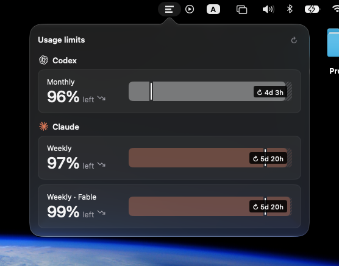

# AI Limits

A macOS menu bar app that shows your Codex and Claude usage limits in a popover.

<p align="center">
  
</p>

Limits are read through the official `codex` and `claude` CLIs, only when you open the popover. No tokens are read and no prompts are sent.

Built with [MyGo](https://mygo.run).

```sh
go tool mygo dev     # run
go tool mygo build   # build/darwin-arm64/AI Limits.app
```
